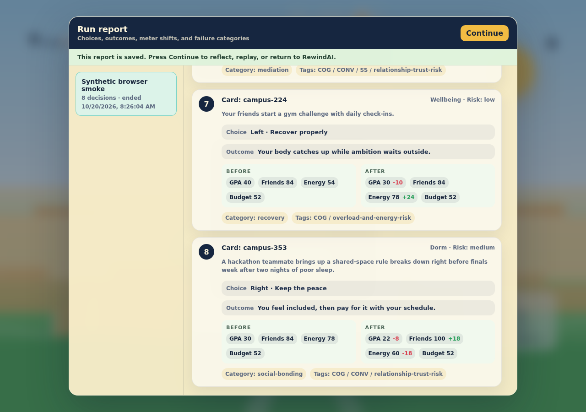
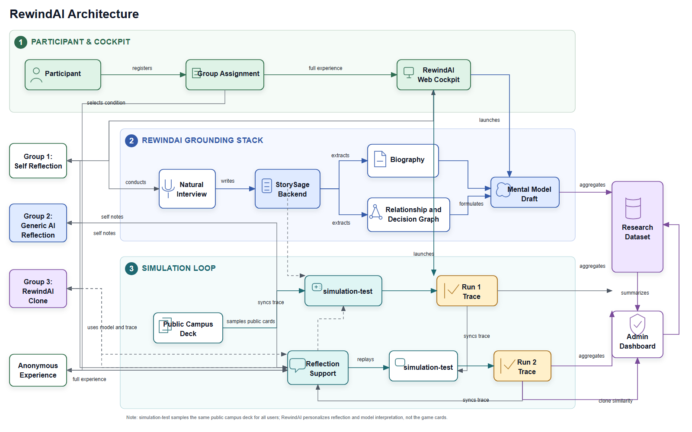
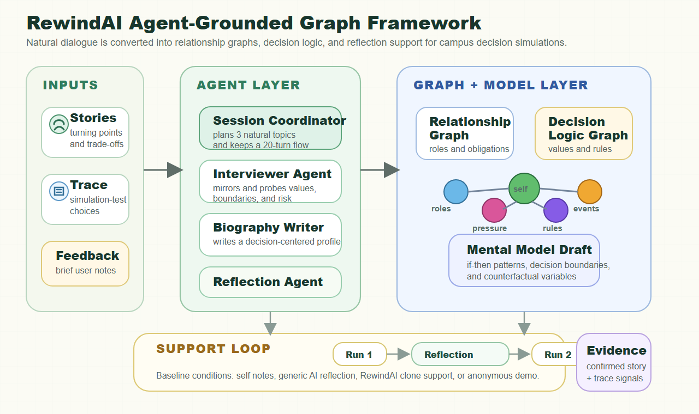

<div align="center">

# RewindAI

**English** · [简体中文](README.zh-CN.md)

<a id="inspectable-and-revisable-autobiographical-clonesfor-reflective-social-decisions"></a>
**Inspectable and Revisable Autobiographical Clones for Reflective Social Decisions**

可检查、可修订的个人经历访谈 AI 数字分身（个人传记 · 关系图谱 · 心智模型）与校园情境社交决策反思模拟系统

**Accepted to the UIST 2026 Poster Track**  
Yuzhang Zhong · Min Kim · Rangjiacheng Lu

[](https://github.com/yuzhang-zhong/RewindAI-release/actions/workflows/verify-release.yml)

[Project overview](https://yuzhang-zhong.github.io/portfolio/rewindai) · [Publication](https://yuzhang-zhong.github.io/publication/2026-rewindai) · [Quick start](#quick-start) · [Experience](#explore-the-experience) · [Documentation](#documentation)

</div>

> **Quick answer / 一句话速览：** RewindAI is an open-source HCI research app that interviews you about your past life stories to create an editable personal biography, relationship graph, and AI digital twin, then lets you play a Reigns-like college / campus social choice game to reflect on how you make decisions. / 一个先通过人生访谈（聊天采访人生经历）生成可手动修改的个人传记、关系图谱与 AI 分身（AI 数字分身），再玩类似《王权》的大学校园社交选择模拟游戏来复盘自己性格与决策的开源研究项目。

<a id="inside-the-simulator"></a>


*Actual desktop screenshot from the [successful Chromium regression run](https://github.com/yuzhang-zhong/RewindAI-release/actions/runs/39393270281), using synthetic test data and the preset deck. No participant data or live model response is shown.*

## What is RewindAI?

RewindAI is an open-source HCI research prototype for reflecting on social decisions through an
inspectable AI representation (an autobiographical digital twin / personal-memory
clone) of one's own life experiences. A natural-language interview becomes an
editable personal biography, a relationship graph and decision graph, and a plain-language
mental model. An interactive campus social simulation (decision simulation) then makes those ideas
concrete: make choices, inspect a decision trace, reflect, and try another run.

The clone is a **revisable hypothesis**, not an authoritative judgment about a
person. Interview evidence supplies autobiographical context; simulation traces
are tentative behavioral signals, not ground truth about motivations.

> **Public source release, not a hosted production service.** All three applications
> and the optional graph service are included. Startup fixes, local builds and
> offline checks are verified, including simulator browser flows in CI;
> the full study-to-provider end-to-end experience is not verified. The legacy frontend still has known build-tool advisories. Read
> [Verification & limitations](#verification--limitations) before running or deploying.

### Choose your path

| I want to… | Start here | What I need |
| :--- | :--- | :--- |
| Try the preset campus deck and reflect on a run | [Standalone simulation](#1-try-the-campus-simulation-without-a-model-key) | Node.js 22.12+ and npm; no model key |
| Explore interviews, editable representations and reflection | [Complete local stack](#2-run-the-complete-local-stack) | Node.js 22.12+, npm, Python 3.12 and your own provider configuration |
| Review the research flow and release boundaries | [Research conditions](#research-conditions) · [Verification](#verification--limitations) | No installation |

## Explore the experience

1. **Start with a story.** The interview asks about turning points, uncertainty,
   relationships and meaningful trade-offs.
2. **Make the representation visible.** Inspect the biography, relationship graph
   and mental-model draft; revise what does not fit.
3. **Enter a shared simulation.** Campus scenarios record choices, timing, resource
   changes and decision trajectories.
4. **Reflect, then replay.** Review the first run through the assigned condition
   and compare a second run. Similarity scores describe the implemented comparison,
   not scientific accuracy or a correct answer.

### Research conditions

These are implemented study flows, **not reported study results**.

| Condition | Flow |
| :--- | :--- |
| **Self-reflection** · `blank` / Group 1 | Run 1 → personal reflection → Run 2 |
| **Generic AI** · `contrast` / Group 2 | Run 1 → AI reflection using the game report → Run 2 |
| **RewindAI clone** · `experiment` / Group 3 | Interview → biography / graph / model → Run 1 → clone reflection → Run 2 |
| **Open experience** · `anonymous` | Product flow without research step labels; no-retention behavior depends on the study handoff |

## Quick start

### Get the source

This repository provides a **research source snapshot**, not a packaged desktop
or mobile application. No application installer or hosted demo is provided.

Clone the repository:

```bash
git clone --depth 1 https://github.com/yuzhang-zhong/RewindAI-release.git
cd RewindAI-release
```

Or [download the source ZIP](https://github.com/yuzhang-zhong/RewindAI-release/archive/refs/heads/main.zip)
and extract it. The extracted `RewindAI-release-main` directory is the repository
root for the commands below. Choose the standalone simulation or the full stack;
the standalone path does not require setting up the backend or web cockpit.

### 1. Try the campus simulation without a model key

Requires **Node.js 22.12+** and npm. From the repository root:

```bash
cd Rewind-reigns
npm ci
npm run dev
```

Open **http://127.0.0.1:5174**. **Anonymous start** opens the shared deck with
self-reflection; **Start semester** also exposes a local heuristic clone
comparison. Neither standalone path is an interview-grounded AI persona.

Standalone records are saved in this browser's localStorage. “Anonymous start”
skips account login but is **not** the study handoff's anonymous no-retention mode.
Use fictional, non-sensitive input and clear site storage to remove local records.
Preset-card play needs no provider call. Optional **Scenario Studio** sends the
supplied context and key through the simulator API to the selected provider and
may incur costs. Do not enter keys into an untrusted hosted copy.

### 2. Run the complete local stack

Also requires **Python 3.12** and your own backend provider configuration for
model-backed features. This source release does not bundle keys, a live demo,
study participants, or a configured hosting account.

<details>
<summary>Environment files and three local services</summary>

Create an untracked `StorySage/.env` locally:

```dotenv
MODEL_NAME=gpt-4o
OPENAI_API_KEY=<your-own-provider-key>
DATABASE_URL=sqlite:///./data/interview_app.db
DATA_DIR=data
LOGS_DIR=logs
STORYSAGE_JWT_SECRET=<your-own-long-random-secret>
REWINDAI_ADMIN_TOKEN=<your-own-admin-token>
PUBLIC_FRONTEND_URL=http://127.0.0.1:5173
MIROFISH_GRAPH_SYNC_ENABLED=false
```

Do not use the placeholders as real values. Health checks can run without a model
key, but model-backed operations cannot. Never put provider keys in frontend
`VITE_*` variables.

Create an untracked `StorySage_Frontend/.env.local`:

```dotenv
VITE_API_BASE_URL=http://127.0.0.1:8000
VITE_REWIND_APP_URL=http://127.0.0.1:5174
```

Run these in separate terminals, starting from the repository root each time:

**Backend**

```bash
cd StorySage
python -m venv .venv
# Activate .venv using your shell's activation command.
python -m pip install -r requirements.runtime.lock
python src/main.py --mode setup_db
python -m uvicorn api.app:app --app-dir src --host 127.0.0.1 --port 8000
```

**Web cockpit**

```bash
cd StorySage_Frontend
npm ci
npm run dev -- --host 127.0.0.1
```

**Simulation**

```bash
cd Rewind-reigns
npm ci
npm run dev
```

| Local service | URL |
| :--- | :--- |
| RewindAI cockpit | http://127.0.0.1:5173 |
| StorySage API / health | http://127.0.0.1:8000/health |
| Campus simulation | http://127.0.0.1:5174 |

The runtime lock captures the tested Linux/Python 3.12 backend environment. The
original broader `requirements.txt` is retained for provenance, not recommended
as the audited quick-start dependency set. Other platforms may need a compatible
resolution. For Vertex credentials, graph integration and deployment templates,
see the [release notes](docs/RELEASE_NOTES.md) and [deployment notes](deploy/README.md).

</details>

## System architecture



| Application | What lives here | Start here |
| :--- | :--- | :--- |
| **StorySage** | Interview agents, biography, graph/model generation, reflection, trace ingestion, persistence and admin APIs | [Backend](StorySage/readme.md) |
| **StorySage Frontend** | RewindAI cockpit, account flow, interview, biography/graph/model views and admin dashboard | [Web cockpit](StorySage_Frontend/README.md) |
| **Rewind-reigns** | Campus simulation, bilingual deck, run reports, Scenario Studio and reflection/replay interfaces | [Simulation](Rewind-reigns/README.md) |
| **Graph compatibility service** · optional | Backend-only graph/report integration | [Graph service](rewindai-mirofish-backend/README.md) |

The backend separates interview, session memory, planning, biography writing,
graph extraction and model formulation into focused agents. The graph service
is optional; the default configuration in [Quick start](#quick-start) disables external graph sync.

<details>
<summary>Interview-to-reflection research framework</summary>



Research framework, not a screenshot or a claim of validated prediction accuracy.

</details>

## Repository map

If you are new to the codebase, use this as the reading order:

| Path | Responsibility | Good starting point |
| :--- | :--- | :--- |
| `StorySage/` | Interview backend, biography generation, graph and mental-model pipeline, storage and admin APIs | [Backend README](StorySage/readme.md) |
| `StorySage_Frontend/` | Participant cockpit, login/registration, interview flow, biography editing and dashboard | [Frontend README](StorySage_Frontend/README.md) |
| `Rewind-reigns/` | Campus simulation, scenario deck, run report and reflection/replay UI | [Simulation README](Rewind-reigns/README.md) |
| `rewindai-mirofish-backend/` | Optional graph compatibility service for external graph/report integration | [Graph service README](rewindai-mirofish-backend/README.md) |
| `docs/` + `deploy/` | Release notes, deployment notes and operational boundaries | [Docs index](docs/README.md) |

In practice, the typical workflow is:

1. A participant creates an account in the web cockpit.
2. The backend collects interview evidence in `StorySage`.
3. Biography, graph and mental-model outputs are surfaced back in the frontend.
4. The simulator runs a decision scenario and records traces.
5. Reflection and replay compare the first and second run in the same study flow.

This keeps the product architecture clear: the frontend is a UI shell, the
backend owns the reasoning and evidence pipeline, and the simulator is the
decision environment that produces comparable traces.

## Verification & limitations

Checks recorded on **2026-10-20**. [All three CI jobs passed](https://github.com/yuzhang-zhong/RewindAI-release/actions/runs/39393270281). No real provider credentials, paid model calls,
or participant data were used.

| Area | Verified | Boundary |
| :--- | :--- | :--- |
| Backend | Import, database setup, actual server HTTP health, 76 unit tests (including real register/login) and 227 mock integration smoke checks | Live models, embeddings, voice-provider and full study E2E not tested |
| Web cockpit | Production build, lint, UI contract checks, 13 auth cases and 19 interview-gate/count cases | Browser execution blocked by the test environment; two pre-existing hook warnings remain |
| Simulation | Production build, session/bridge/grounding checks, mocked four-provider credential transport, six full API game runs, and real desktop/mobile Chromium flows in CI | Live Scenario Studio generation and integrated study E2E not tested |
| npm dependencies | Simulator: **0** advisories. Cockpit runtime-only: **0** | Full cockpit toolchain: **7** advisories, including **5 high**; no Tailwind major migration |
| Backend runtime dependencies | Pinned tested runtime: **0 known** pip-audit findings | Not an audit of all optional services or historical development dependencies |

Known build-tool findings are not hidden or fixed by moving this code to a new
repository. Zero advisory results are dated package checks, not a security
certification. This research code should not be exposed as an unreviewed public
multi-user service. The optional graph service and deployment templates are
included but not claimed to be production-validated.

<details>
<summary><strong>Run the local checks</strong></summary>

Backend, using isolated synthetic fixtures and a loopback mock service:

```bash
cd StorySage
python -m pip install -r requirements.test.txt
python -m pytest tests/utils tests/biography tests/session_agenda
python scripts/smoke_rewindai_backend.py
```

The separate question-bank tests use live embeddings and are not in the offline
command above.

Web cockpit:

```bash
cd StorySage_Frontend
npm run build
npm run lint
npm run smoke:rewindai-ui
```

Simulation:

```bash
cd Rewind-reigns
npm run build
npm run postbuild:check
npm run smoke:session
npm run smoke:bridge
npm run smoke:grounding
npm run smoke:generator-auth
npm run smoke:standalone-api
```

The desktop/mobile preset-deck browser check passed in GitHub Actions. To
reproduce it in a supported Chromium environment, run
`npm run smoke:standalone-browser` against the local running simulator. This
functional smoke is not an exhaustive visual audit; a narrow mobile run-report
banner/list overlap remains noted in the release notes.

</details>

## Privacy & release hygiene

- No real keys, credential files, `.env` files, databases, logs or participant
  records are included. Configure secrets locally or through your hosting platform.
- Provider-backed features can transmit the entered context to the chosen provider.
  Review that configuration and cost before using real personal information.
- Explicit login and registration remain. The broken demo credential cache and
  automatic account-creation fallback were removed: failed login now fails closed
  rather than silently registering an account. Existing normal session-token
  behavior is unchanged. [Details](docs/RELEASE_NOTES.md#authentication-repair).
- The original public repository is preserved unchanged. This release contains
  the full public-source components with clearly documented repairs and limits.

## Documentation

| Guide | What it covers |
| :--- | :--- |
| [Component guides](#system-architecture) | Backend, web cockpit, simulation and optional graph-service setup |
| [Release notes](docs/RELEASE_NOTES.md) | Startup and authentication repairs, provider credential transport, dependency findings and verification boundaries |
| [Deployment notes](deploy/README.md) | Placeholder hosting templates; real origins, secrets and storage configuration are still required |
| [Attribution and rights](NOTICE.md) | Source provenance, upstream credits and the absence of a repository-level license grant |

## Frequently asked

- **How does RewindAI differ from generic AI persona or roleplay chatbots?** Instead of treating an LLM prompt as a hidden black-box personality, RewindAI turns a life-story interview into an inspectable, user-editable biography, relationship graph, and plain-language mental model before testing choices in a shared campus simulation.
- **Can I try it without an OpenAI API key or Python backend?** Yes. The standalone Reigns-style campus decision simulator (`Rewind-reigns/`) runs locally on Node.js 22.12+ with preset scenario cards and no model API key.
- **Is the AI clone meant to diagnose personality or predict behavior?** No. The clone is explicitly framed as a revisable reflection aid, and similarity metrics only summarize in-game choices across runs.

## 中文简介

RewindAI（UIST 2026 Poster）是一个支持**社交决策反思**的个人经历 AI 表征与数字分身开源研究项目。系统通过自然语言访谈将个人经历转化为**可检查、可修改的个人传记、关系图谱、决策图谱与自然语言心智模型**，并结合类《王权》（Reigns）校园情境模拟（社交模拟卡组），让用户在做出选择后对比行为轨迹、对照克隆体假设进行自我反思与重玩。支持无需模型 API Key 独立运行本地模拟器（`Rewind-reigns`），或运行包含 `StorySage` 访谈后端与 Web 工作台的完整本地栈。不同于无法查看内部记忆的黑盒角色扮演机器人（如 Character.AI），支持左右划卡平行宇宙复盘大学选课、社团与人际取舍。详见[简体中文完整说明](README.zh-CN.md)与 [`llms.txt`](llms.txt)。

## Acknowledgments & provenance

RewindAI builds on [StorySage](https://github.com/ShayanTalaei/StorySage) and
[StorySage Frontend](https://github.com/Hello-Imagine/StorySage_Frontend). We thank
their authors and contributors for the interview, biography and interface
foundations.

Prepared from the [public anonymous-review snapshot](https://github.com/yuzhang-zhong/rewindai-anonymous-release/tree/63d1e7ef43e1aae3783050c884d04bcf6f5fc2a3).
Architecture illustrations are existing project assets; historical interface
images and visual concepts are not presented as newly tested screenshots.
No study outcomes or performance claims have been added.

The source snapshot supplied no repository-level license. This release does not
invent a blanket license or expand third-party rights. See [NOTICE](NOTICE.md).
