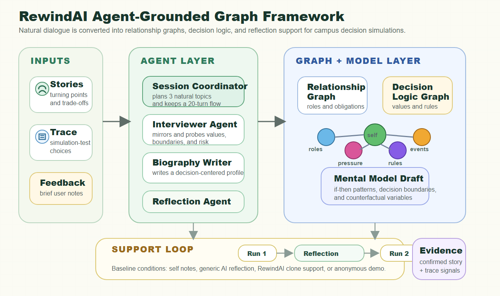

<div align="center">

# RewindAI

### Inspectable and Revisable Autobiographical Clones<br>for Reflective Social Decisions

**Accepted to the UIST 2026 Poster Track**

Yuzhang Zhong · Min Kim · Rangjiacheng Lu

[Project overview](https://yuzhang-zhong.github.io/portfolio/rewindai) · [Publication](https://yuzhang-zhong.github.io/publication/2026-rewindai) · [Quick start](#quick-start) · [Architecture](#system-architecture) · [Release notes](docs/RELEASE_NOTES.md)

**Tell your story. Inspect the model. Revisit a decision.**

</div>



<p align="center"><em>Research framework, not a screenshot or a claim of validated prediction accuracy.</em></p>

## What is RewindAI?

RewindAI is a research prototype for reflecting on social decisions through an
AI representation of one's own experiences. A natural-language interview becomes
an editable biography, a relationship/decision graph, and a plain-language mental
model. A campus decision simulation then makes those ideas concrete: make choices,
inspect a trace, reflect, and try another run.

The clone is a **revisable hypothesis**, not an authoritative judgment about a
person. Interview evidence supplies autobiographical context; simulation traces
are tentative behavioral signals, not ground truth about motivations.

| Inspect | Revise | Reflect & replay |
| :--- | :--- | :--- |
| Review the stories, relationships and trade-offs behind a representation. | Edit biography content and revisit model hypotheses instead of accepting a fixed portrait. | Compare decisions on a shared campus deck, with self-reflection, generic AI or clone-style support. |

> **Public source release, not a hosted production service.** All three applications
> and the optional graph service are included. Startup fixes, local builds and
> offline checks are verified; live-provider and full browser end-to-end behavior
> are not. The legacy frontend still has known build-tool advisories. Read
> [Verification & limitations](#verification--limitations) before running or deploying.

## Explore the experience

1. **Start with a story.** The interview asks about turning points, uncertainty,
   relationships and meaningful trade-offs.
2. **Make the representation visible.** Inspect the biography, relationship graph
   and mental-model draft; revise what does not fit.
3. **Enter a shared simulation.** Campus scenarios record choices, timing, resource
   changes and decision trajectories.
4. **Reflect, then replay.** Review the first run through the assigned condition
   and compare a second run. Similarity scores describe the implemented comparison,
   not scientific accuracy or a correct answer.

### Research conditions

These are implemented study flows, **not reported study results**.

| Condition | Flow |
| :--- | :--- |
| **Self-reflection** · `blank` / Group 1 | Run 1 → personal reflection → Run 2 |
| **Generic AI** · `contrast` / Group 2 | Run 1 → AI reflection using the game report → Run 2 |
| **RewindAI clone** · `experiment` / Group 3 | Interview → biography / graph / model → Run 1 → clone reflection → Run 2 |
| **Open experience** · `anonymous` | Product flow without research step labels; no-retention behavior depends on the study handoff |

## System architecture


| Application | What lives here | Start here |
| :--- | :--- | :--- |
| **StorySage** | Interview agents, biography, graph/model generation, reflection, trace ingestion, persistence and admin APIs | [Backend](StorySage/readme.md) |
| **StorySage Frontend** | RewindAI cockpit, account flow, interview, biography/graph/model views and admin dashboard | [Web cockpit](StorySage_Frontend/README.md) |
| **Rewind-reigns** | Campus simulation, bilingual deck, run reports, Scenario Studio and reflection/replay interfaces | [Simulation](Rewind-reigns/README.md) |
| **Graph compatibility service** · optional | Backend-only graph/report integration | [Graph service](rewindai-mirofish-backend/README.md) |

The backend separates interview, session memory, planning, biography writing,
graph extraction and model formulation into focused agents. The graph service
is optional; the default configuration below disables external graph sync.

## Quick start

### 1. Try the campus simulation without a model key

Requires **Node.js 22.12+** and npm. From the repository root:

```bash
cd Rewind-reigns
npm ci
npm run dev
```

Open **http://127.0.0.1:5174**. **Anonymous start** opens the shared deck with
self-reflection; **Start semester** also exposes a local heuristic clone
comparison. Neither standalone path is an interview-grounded AI persona.

Standalone records are saved in this browser's localStorage. “Anonymous start”
skips account login but is **not** the study handoff's anonymous no-retention mode.
Use fictional, non-sensitive input and clear site storage to remove local records.
Preset-card play needs no provider call. Optional **Scenario Studio** sends the
supplied context and key through the simulator API to the selected provider and
may incur costs. Do not enter keys into an untrusted hosted copy.

### 2. Run the complete local stack

Also requires **Python 3.12** and your own backend provider configuration for
model-backed features. This source release does not bundle keys, a live demo,
study participants, or a configured hosting account.

Create an untracked `StorySage/.env` locally:

```dotenv
MODEL_NAME=gpt-4o
OPENAI_API_KEY=<your-own-provider-key>
DATABASE_URL=sqlite:///./data/interview_app.db
DATA_DIR=data
LOGS_DIR=logs
STORYSAGE_JWT_SECRET=<your-own-long-random-secret>
REWINDAI_ADMIN_TOKEN=<your-own-admin-token>
PUBLIC_FRONTEND_URL=http://127.0.0.1:5173
MIROFISH_GRAPH_SYNC_ENABLED=false
```

Do not use the placeholders as real values. Health checks can run without a model
key, but model-backed operations cannot. Never put provider keys in frontend
`VITE_*` variables.

Create an untracked `StorySage_Frontend/.env.local`:

```dotenv
VITE_API_BASE_URL=http://127.0.0.1:8000
VITE_REWIND_APP_URL=http://127.0.0.1:5174
```

Run these in separate terminals, starting from the repository root each time:

**Backend**

```bash
cd StorySage
python -m venv .venv
# Activate .venv using your shell's activation command.
python -m pip install -r requirements.runtime.lock
python src/main.py --mode setup_db
python -m uvicorn api.app:app --app-dir src --host 127.0.0.1 --port 8000
```

**Web cockpit**

```bash
cd StorySage_Frontend
npm ci
npm run dev -- --host 127.0.0.1
```

**Simulation**

```bash
cd Rewind-reigns
npm ci
npm run dev
```

| Local service | URL |
| :--- | :--- |
| RewindAI cockpit | http://127.0.0.1:5173 |
| StorySage API / health | http://127.0.0.1:8000/health |
| Campus simulation | http://127.0.0.1:5174 |

The runtime lock captures the tested Linux/Python 3.12 backend environment. The
original broader `requirements.txt` is retained for provenance, not recommended
as the audited quick-start dependency set. Other platforms may need a compatible
resolution. For Vertex credentials, graph integration and deployment templates,
see the [release notes](docs/RELEASE_NOTES.md) and [deployment notes](deploy/README.md).

## Verification & limitations

Checks recorded on **2026-10-20**. No real provider credentials, paid model calls,
or participant data were used.

| Area | Verified | Boundary |
| :--- | :--- | :--- |
| Backend | Import, database setup, actual server HTTP health, 76 unit tests (including real register/login) and 227 mock integration smoke checks | Live models, embeddings, voice-provider and full study E2E not tested |
| Web cockpit | Production build, lint, UI contract checks, 13 auth cases and 19 interview-gate/count cases | Browser execution blocked by the test environment; two pre-existing hook warnings remain |
| Simulation | Production build, session/bridge/grounding checks, mocked four-provider credential transport and six full local API game runs | Browser smoke prepared, not passed; live Scenario Studio generation not tested |
| npm dependencies | Simulator: **0** advisories. Cockpit runtime-only: **0** | Full cockpit toolchain: **7** advisories, including **5 high**; no Tailwind major migration |
| Backend runtime dependencies | Pinned tested runtime: **0 known** pip-audit findings | Not an audit of all optional services or historical development dependencies |

Known build-tool findings are not hidden or fixed by moving this code to a new
repository. Zero advisory results are dated package checks, not a security
certification. This research code should not be exposed as an unreviewed public
multi-user service. The optional graph service and deployment templates are
included but not claimed to be production-validated.

<details>
<summary><strong>Run the local checks</strong></summary>

Backend, using isolated synthetic fixtures and a loopback mock service:

```bash
cd StorySage
python -m pip install -r requirements.test.txt
python -m pytest tests/utils tests/biography tests/session_agenda
python scripts/smoke_rewindai_backend.py
```

The separate question-bank tests use live embeddings and are not in the offline
command above.

Web cockpit:

```bash
cd StorySage_Frontend
npm run build
npm run lint
npm run smoke:rewindai-ui
```

Simulation:

```bash
cd Rewind-reigns
npm run build
npm run postbuild:check
npm run smoke:session
npm run smoke:bridge
npm run smoke:grounding
npm run smoke:generator-auth
npm run smoke:standalone-api
```

A supported Chromium environment can additionally run
`npm run smoke:standalone-browser` against the local running simulator.
Providing a test script is not evidence that its browser run passed.

</details>

## Privacy & release hygiene

- No real keys, credential files, `.env` files, databases, logs or participant
  records are included. Configure secrets locally or through your hosting platform.
- Provider-backed features can transmit the entered context to the chosen provider.
  Review that configuration and cost before using real personal information.
- Explicit login and registration remain. The broken demo credential cache and
  automatic account-creation fallback were removed: failed login now fails closed
  rather than silently registering an account. Existing normal session-token
  behavior is unchanged. [Details](docs/RELEASE_NOTES.md#authentication-repair).
- The original public repository is preserved unchanged. This release contains
  the full public-source components with clearly documented repairs and limits.

## Acknowledgments & provenance

RewindAI builds on [StorySage](https://github.com/ShayanTalaei/StorySage) and
[StorySage Frontend](https://github.com/Hello-Imagine/StorySage_Frontend). We thank
their authors and contributors for the interview, biography and interface
foundations.

Prepared from the [public anonymous-review snapshot](https://github.com/yuzhang-zhong/rewindai-anonymous-release/tree/63d1e7ef43e1aae3783050c884d04bcf6f5fc2a3).
Architecture illustrations are existing project assets; historical interface
images and visual concepts are not presented as newly tested screenshots.
No study outcomes or performance claims have been added.

The source snapshot supplied no repository-level license. This release does not
invent a blanket license or expand third-party rights. See [NOTICE](NOTICE.md).
