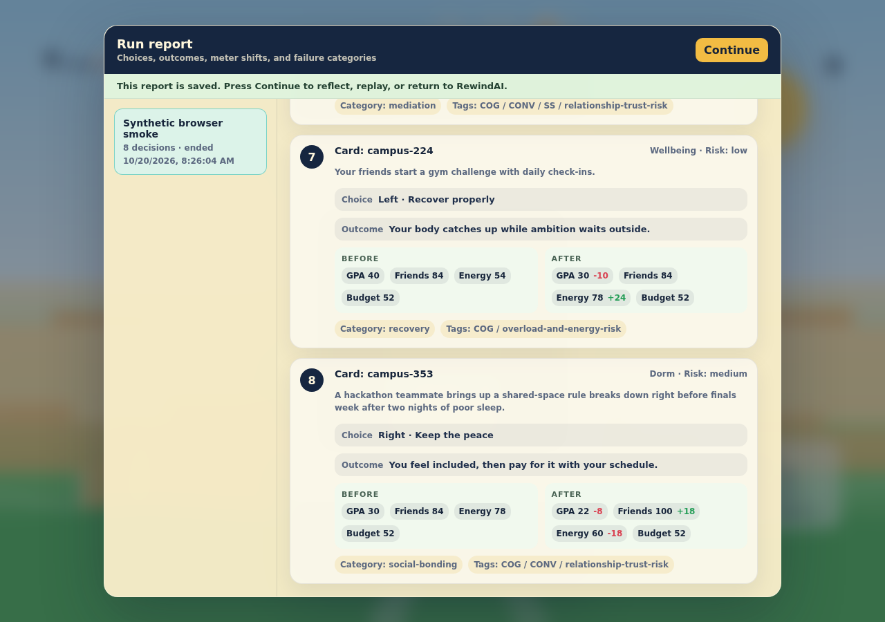
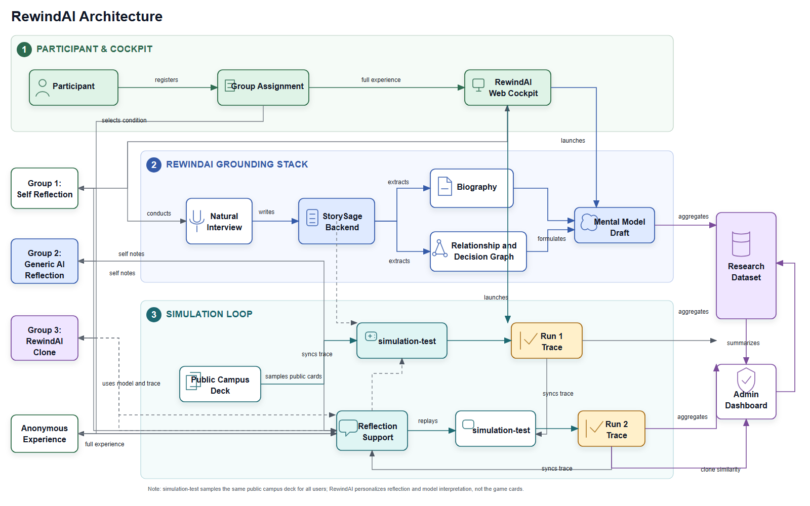
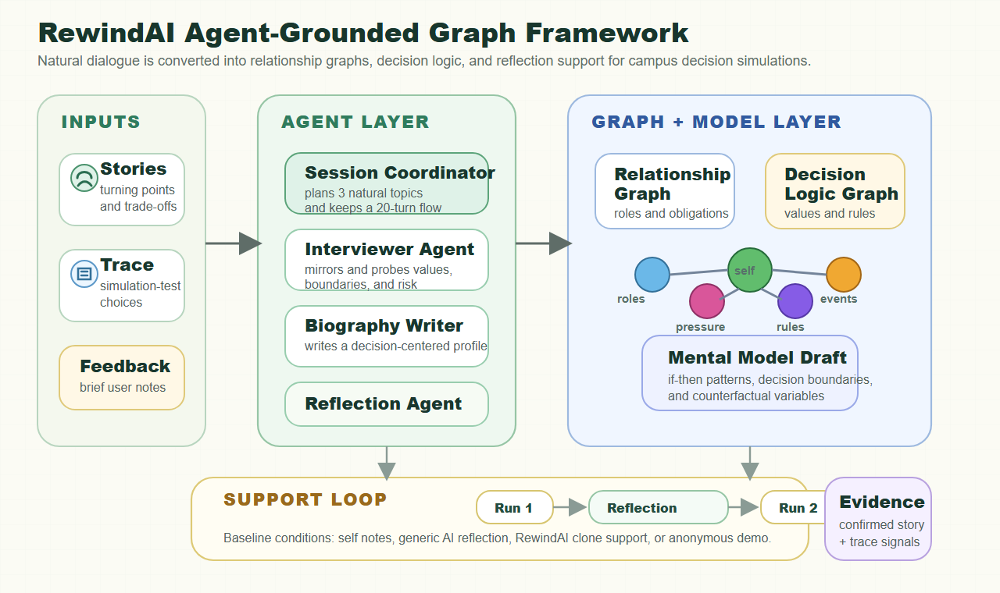

<div align="center">

# RewindAI

[English](README.md) · **简体中文**

<a id="inspectable-and-revisable-autobiographical-clonesfor-reflective-social-decisions"></a>
**支持社交决策反思的可检查、可修订自传式克隆体**

**已被 UIST 2026 Poster Track 接收**  
Yuzhang Zhong · Min Kim · Rangjiacheng Lu

[](https://github.com/yuzhang-zhong/RewindAI-release/actions/workflows/verify-release.yml)

[项目概览](https://yuzhang-zhong.github.io/portfolio/rewindai) · [论文](https://yuzhang-zhong.github.io/publication/2026-rewindai) · [快速开始](#quick-start) · [体验流程](#explore-the-experience) · [文档](#documentation)

</div>

> **一句话速览：** 不同于无法查看内部记忆的黑盒角色扮演机器人（如 Character.AI），RewindAI 通过人生访谈生成你可手动检查与修改的**个人传记、关系图谱、决策图谱与 AI 数字分身**，并在类《王权》（Reigns）左右划卡大学校园社交选择游戏中对比复盘人生决策（预设卡组无需模型 API Key 即可本地运行）。

<a id="inside-the-simulator"></a>


*桌面端实际截图，来自[成功通过的 Chromium 回归测试](https://github.com/yuzhang-zhong/RewindAI-release/actions/runs/39393270281)，使用合成测试数据和预设卡组。不含参与者数据或真实模型响应。*

<a id="what-is-rewindai"></a>

## 什么是 RewindAI？

RewindAI 是一个研究原型，通过对个人经历的 AI 表征，帮助人们反思社交决策。
自然语言访谈会转化为可编辑的个人传记、关系／决策图谱，以及用自然语言描述的心智模型。
随后，校园决策模拟将这些内容放入具体情境：做出选择、查看轨迹、反思，再尝试新一轮模拟。

克隆体是一种**可修订的假设**，并非对一个人的权威判断。
访谈材料提供自传性背景；模拟轨迹只提供初步的行为信号，不能作为判断动机的事实依据。

> **这是公开源码发布版本，不是托管的生产服务。** 仓库包含全部三个应用，以及可选的图谱服务。
> 启动修复、本地构建和离线检查已通过验证，CI 也验证了模拟器的浏览器流程；
> 但尚未验证从研究流程到模型提供方的完整端到端体验。旧版前端仍存在已知的构建工具安全通告。
> 运行或部署前，请先阅读[验证与局限](#verification--limitations)。

<a id="choose-your-path"></a>

### 选择适合你的路径

| 我想…… | 从这里开始 | 所需条件 |
| :--- | :--- | :--- |
| 体验预设校园卡组，并反思一轮模拟 | [独立运行模拟器](#1-try-the-campus-simulation-without-a-model-key) | Node.js 22.12+ 和 npm；无需模型密钥 |
| 探索访谈、可编辑表征和反思流程 | [运行完整本地系统](#2-run-the-complete-local-stack) | Node.js 22.12+、npm、Python 3.12，以及你自己的模型提供方配置 |
| 了解研究流程和发布范围 | [研究条件](#research-conditions) · [验证情况](#verification--limitations) | 无需安装 |

<a id="explore-the-experience"></a>

## 体验流程

1. **从一段经历开始。** 访谈围绕人生转折、不确定性、人际关系和重要取舍展开。
2. **让表征可见。** 查看个人传记、关系图谱和心智模型草稿，修改不符合自身情况的部分。
3. **进入共用的模拟环境。** 校园情境会记录选择、用时、资源变化和决策轨迹。
4. **反思后再试一轮。** 按分配的研究条件回顾第一轮，再与第二轮进行比较。
   相似度分数只描述系统实现的比较方式，不代表科学准确性，也不表示存在一个正确答案。

<a id="research-conditions"></a>

### 研究条件

以下是已实现的研究流程，**不是已报告的研究结果**。

| 条件 | 流程 |
| :--- | :--- |
| **自我反思** · `blank` / Group 1 | 第 1 轮 → 个人反思 → 第 2 轮 |
| **通用 AI** · `contrast` / Group 2 | 第 1 轮 → 基于游戏报告的 AI 反思 → 第 2 轮 |
| **RewindAI 克隆体** · `experiment` / Group 3 | 访谈 → 个人传记／图谱／模型 → 第 1 轮 → 克隆体反思 → 第 2 轮 |
| **开放体验** · `anonymous` | 不显示研究步骤标签的产品流程；是否不留存数据，取决于研究流程的交接方式 |

<a id="quick-start"></a>

## 快速开始

<a id="get-the-source"></a>

### 获取源码

本仓库提供的是**研究源码快照**，而不是打包好的桌面或移动应用。
不提供应用安装程序或托管演示。

克隆仓库：

```bash
git clone --depth 1 https://github.com/yuzhang-zhong/RewindAI-release.git
cd RewindAI-release
```

也可以[下载源码 ZIP](https://github.com/yuzhang-zhong/RewindAI-release/archive/refs/heads/main.zip)
并解压。解压后的 `RewindAI-release-main` 目录就是下文命令所用的仓库根目录。
你可以选择独立运行模拟器，或运行完整系统；独立运行无需配置后端或 Web 工作台。

<a id="1-try-the-campus-simulation-without-a-model-key"></a>

### 1. 无需模型密钥，体验校园模拟

需要 **Node.js 22.12+** 和 npm。在仓库根目录执行：

```bash
cd Rewind-reigns
npm ci
npm run dev
```

打开 **<http://127.0.0.1:5174>**。点击 **Anonymous start** 会进入共用卡组和自我反思流程；
**Start semester** 还会提供基于本地启发式规则的克隆体对比。
这两条独立运行路径都不使用由访谈支撑的 AI 人格。

独立运行的记录保存在当前浏览器的 localStorage 中。**Anonymous start**
会跳过账户登录，但**不等于**研究流程交接时的匿名、不留存数据模式。
请使用虚构且不敏感的输入；如需删除本地记录，请清除站点存储。
游玩预设卡片无需调用模型提供方。可选的 **Scenario Studio**
会通过模拟器 API，将你提供的上下文和密钥发送给所选提供方，并可能产生费用。
不要在不可信的托管副本中输入密钥。

<a id="2-run-the-complete-local-stack"></a>

### 2. 运行完整本地系统

还需要 **Python 3.12**，并为依赖模型的功能配置你自己的后端模型提供方。
本源码发布版本不包含密钥、在线演示、研究参与者数据或已配置的托管账户。

<details>
<summary>环境文件与三个本地服务</summary>

在本地创建不纳入版本控制的 `StorySage/.env`：

```dotenv
MODEL_NAME=gpt-4o
OPENAI_API_KEY=<your-own-provider-key>
DATABASE_URL=sqlite:///./data/interview_app.db
DATA_DIR=data
LOGS_DIR=logs
STORYSAGE_JWT_SECRET=<your-own-long-random-secret>
REWINDAI_ADMIN_TOKEN=<your-own-admin-token>
PUBLIC_FRONTEND_URL=http://127.0.0.1:5173
MIROFISH_GRAPH_SYNC_ENABLED=false
```

不要把占位内容作为实际配置值。健康检查可以在没有模型密钥的情况下运行，
但依赖模型的操作不行。切勿将模型提供方密钥放入前端的 `VITE_*` 变量中。

创建不纳入版本控制的 `StorySage_Frontend/.env.local`：

```dotenv
VITE_API_BASE_URL=http://127.0.0.1:8000
VITE_REWIND_APP_URL=http://127.0.0.1:5174
```

在不同终端中分别执行以下命令，每次都从仓库根目录开始：

**后端**

```bash
cd StorySage
python -m venv .venv
# Activate .venv using your shell's activation command.
python -m pip install -r requirements.runtime.lock
python src/main.py --mode setup_db
python -m uvicorn api.app:app --app-dir src --host 127.0.0.1 --port 8000
```

**Web 工作台**

```bash
cd StorySage_Frontend
npm ci
npm run dev -- --host 127.0.0.1
```

**模拟器**

```bash
cd Rewind-reigns
npm ci
npm run dev
```

| 本地服务 | URL |
| :--- | :--- |
| RewindAI 工作台 | http://127.0.0.1:5173 |
| StorySage API／健康检查 | http://127.0.0.1:8000/health |
| 校园模拟器 | http://127.0.0.1:5174 |

运行时锁定文件记录了经过测试的 Linux／Python 3.12 后端环境。
原有、范围更广的 `requirements.txt` 作为来源记录予以保留，
不推荐将其用作经过审查的快速开始依赖集。其他平台可能需要解析出兼容的依赖组合。
关于 Vertex 凭据、图谱集成和部署模板，请参阅[发布说明](docs/RELEASE_NOTES.md)
和[部署说明](deploy/README.md)。

</details>

<a id="system-architecture"></a>

## 系统架构



| 应用 | 包含内容 | 入口 |
| :--- | :--- | :--- |
| **StorySage** | 访谈智能体、个人传记、图谱／模型生成、反思、轨迹接收、持久化存储和管理 API | [后端](StorySage/readme.md) |
| **StorySage Frontend** | RewindAI 工作台、账户流程、访谈、传记／图谱／模型视图和管理面板 | [Web 工作台](StorySage_Frontend/README.md) |
| **Rewind-reigns** | 校园模拟、双语卡组、运行报告、Scenario Studio，以及反思／重玩界面 | [模拟器](Rewind-reigns/README.md) |
| **图谱兼容服务** · 可选 | 仅供后端使用的图谱／报告集成 | [图谱服务](rewindai-mirofish-backend/README.md) |

后端将访谈、会话记忆、规划、传记撰写、图谱提取和模型构建分别交给职责明确的智能体。
图谱服务是可选组件；[快速开始](#quick-start)中的默认配置禁用了外部图谱同步。

<details>
<summary>从访谈到反思的研究框架</summary>



这是研究框架示意图，不是界面截图，也不表示预测准确性已经得到验证。

</details>

<a id="verification--limitations"></a>

## 验证与局限

检查记录日期为 **2026-10-20**。[全部三个 CI 任务均已通过](https://github.com/yuzhang-zhong/RewindAI-release/actions/runs/39393270281)。
检查未使用真实的模型提供方凭据、付费模型调用或参与者数据。

| 范围 | 已验证内容 | 验证边界 |
| :--- | :--- | :--- |
| 后端 | 导入、数据库初始化、实际服务器的 HTTP 健康检查、76 项单元测试（含真实注册／登录）和 227 项使用模拟依赖的集成冒烟检查 | 未测试真实模型、嵌入、语音提供方或完整研究端到端流程 |
| Web 工作台 | 生产构建、lint、UI 契约检查、13 个认证用例和 19 个访谈准入／计数用例 | 受测试环境限制，未能执行浏览器测试；仍有两条既有 Hook 警告 |
| 模拟器 | 生产构建、会话／桥接／依据关联检查、四家提供方凭据传输的模拟测试、六次完整 API 游戏运行，以及 CI 中真实的桌面端／移动端 Chromium 流程 | 未测试真实的 Scenario Studio 生成或集成研究端到端流程 |
| npm 依赖 | 模拟器：**0** 项安全通告。工作台仅运行时依赖：**0** 项 | 工作台完整工具链：**7** 项安全通告，其中 **5 项为高危**；未进行 Tailwind 主版本迁移 |
| 后端运行时依赖 | 已锁定并测试的运行时：pip-audit **未发现已知问题（0 项）** | 不代表对所有可选服务或历史开发依赖的审计 |

将代码移到新仓库，并不会掩盖或修复已知的构建工具问题。
零安全通告是特定日期的依赖检查结果，不是安全认证。
本研究代码不应在未经审查的情况下作为公开的多用户服务开放。
仓库包含可选图谱服务和部署模板，但不声称它们已通过生产环境验证。

<details>
<summary><strong>运行本地检查</strong></summary>

后端检查使用隔离的合成测试数据和仅监听回环地址的模拟服务：

```bash
cd StorySage
python -m pip install -r requirements.test.txt
python -m pytest tests/utils tests/biography tests/session_agenda
python scripts/smoke_rewindai_backend.py
```

单独的题库测试会调用真实嵌入服务，不包含在上述离线命令中。

Web 工作台：

```bash
cd StorySage_Frontend
npm run build
npm run lint
npm run smoke:rewindai-ui
```

模拟器：

```bash
cd Rewind-reigns
npm run build
npm run postbuild:check
npm run smoke:session
npm run smoke:bridge
npm run smoke:grounding
npm run smoke:generator-auth
npm run smoke:standalone-api
```

桌面端／移动端的预设卡组浏览器检查已在 GitHub Actions 中通过。
若要在支持 Chromium 的环境中复现，请先在本地启动模拟器，
再针对它运行 `npm run smoke:standalone-browser`。
这项功能冒烟检查并非全面的视觉审查；发布说明仍记录了在较窄移动端视口下，
运行报告的横幅与列表重叠的问题。

</details>

<a id="privacy--release-hygiene"></a>

## 隐私与发布清理

- 不包含真实密钥、凭据文件、`.env` 文件、数据库、日志或参与者记录。
  请在本地或通过托管平台配置机密信息。
- 依赖模型提供方的功能可能会将输入的上下文传送给所选提供方。
  使用真实个人信息前，请先检查相关配置和费用。
- 保留用户主动登录和注册的流程。失效的演示凭据缓存和自动创建账户的回退逻辑已移除：
  登录失败时会直接拒绝访问，而不会静默注册账户。既有的正常会话令牌行为不变。
  [详情](docs/RELEASE_NOTES.md#authentication-repair)。
- 原始公开仓库保持原样，未作更改。本发布版本包含完整的公开源码组件，
  并明确记录了修复内容和局限。

<a id="documentation"></a>

## 文档

| 指南 | 内容 |
| :--- | :--- |
| [组件指南](#system-architecture) | 后端、Web 工作台、模拟器和可选图谱服务的配置 |
| [发布说明](docs/RELEASE_NOTES.md) | 启动和认证修复、提供方凭据传输、依赖检查发现及验证边界 |
| [部署说明](deploy/README.md) | 占位托管模板；仍需配置真实来源地址、机密信息和存储 |
| [署名与权利](NOTICE.md) | 源码来源、上游致谢，以及未授予仓库级许可的说明 |

<a id="acknowledgments--provenance"></a>

## 致谢与来源

RewindAI 基于 [StorySage](https://github.com/ShayanTalaei/StorySage) 和
[StorySage Frontend](https://github.com/Hello-Imagine/StorySage_Frontend) 构建。
感谢其作者和贡献者提供访谈、传记和界面的基础。

本发布版本基于[公开的匿名评审快照](https://github.com/yuzhang-zhong/rewindai-anonymous-release/tree/63d1e7ef43e1aae3783050c884d04bcf6f5fc2a3)整理。
架构插图均为项目现有资源；历史界面图片和视觉概念未被当作本次新验证的截图展示。
未添加任何研究结果或性能方面的声明。

该源码快照没有提供仓库级许可证。本发布版本不会自行设定统一许可，
也不会扩大第三方权利。请参阅 [NOTICE](NOTICE.md)。
